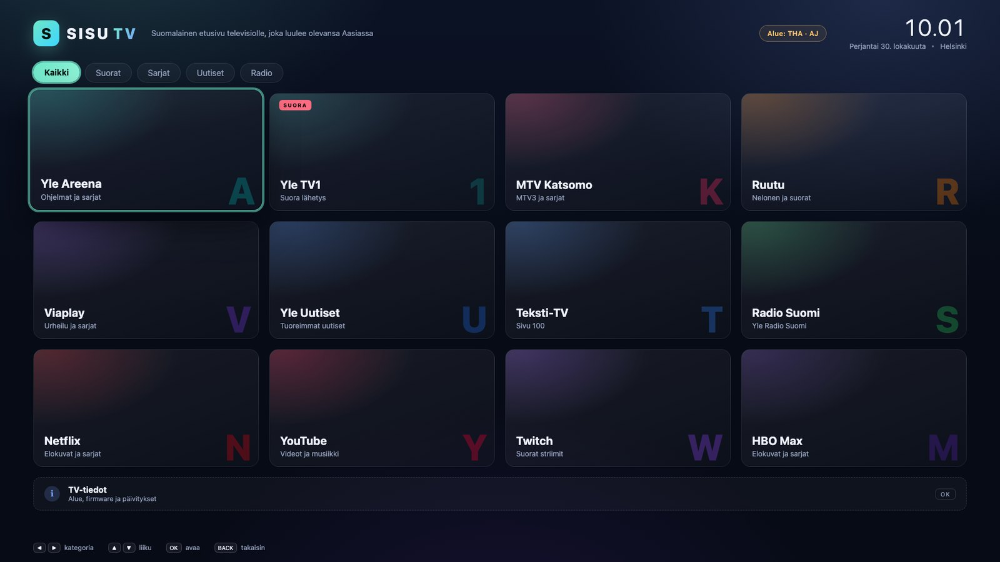
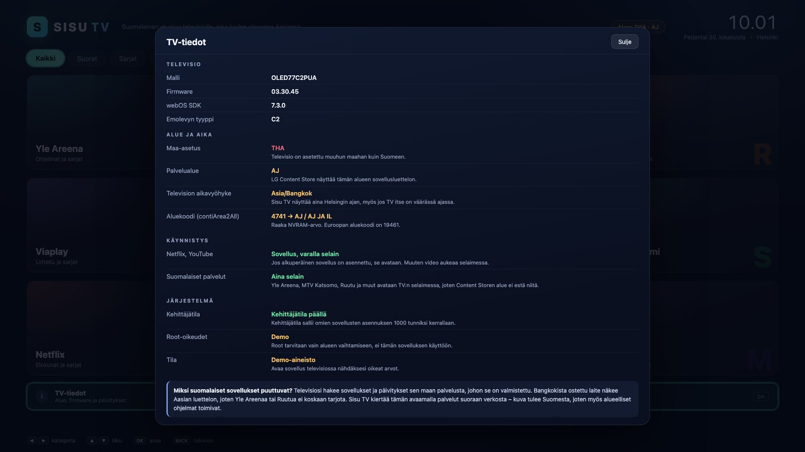
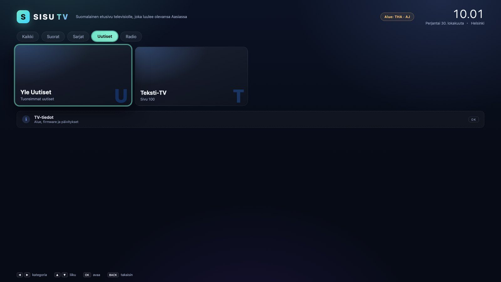

# Sisu TV

**A Finnish front door for an LG C-series OLED that thinks it lives in Bangkok.**



A 77" LG OLED bought in Thailand is a beautiful panel with a frustrating software
life in Finland: the LG Content Store serves it the Asian catalogue, so Yle
Areena, MTV Katsomo and Ruutu are never offered, and firmware updates come from
a channel that has nothing for a Finnish household.

Sisu TV is a small webOS app that fixes the part that can be fixed without
touching the TV's region: it puts a Finnish launcher on the TV, opens those
services straight from the network, and shows you exactly what the TV believes
about itself.

Built for **webOS 22–23 (LG C2 / C3)**, and runs on webOS 4.0 and newer.

| Model year | webOS | Engine | Status |
| --- | --- | --- | --- |
| C2 (2022) | 22 (SDK 7.x) | Chromium 87+ | supported |
| C3 (2023) | 23 (SDK 7.x+) | Chromium 87+ | supported |
| 2024+ | 24+ | Chromium 87+ | untested, same APIs |

The web layer is identical across those releases; what differs is the
firmware-bound Home screen and the rooting profile, which is why
[docs/TAKE-OVER-THE-UI.md](docs/TAKE-OVER-THE-UI.md) starts by reading the
firmware version.

---

## What it does

- **Finnish launcher** – twelve tiles for Yle Areena, Yle TV1, MTV Katsomo,
  Ruutu, Viaplay, Yle Uutiset, Teksti-TV, Radio Suomi, Netflix, YouTube, Twitch
  and HBO Max, grouped into *Kaikki / Suorat / Sarjat / Uutiset / Radio*.
- **Bypasses the store region** – services that have no app on this TV open in
  the built-in browser. The video is fetched from Finland, so geo-restricted
  content behaves as if the TV were Finnish.
- **Native app first** – Netflix and YouTube launch as real apps when installed,
  and fall back to the browser when they are not.
- **A Helsinki clock** – the header always shows Finnish time, even when the TV
  itself is still on `Asia/Bangkok`.
- **TV-tiedot (diagnostics)** – reads the model, firmware, SDK, country,
  service region, time zone and `contiArea2All` NVRAM area code, and explains
  why the Finnish catalogue is missing.
- **Remote-first UI** – arrow keys, OK, BACK and number-key quick launch, no
  pointer required.

| Diagnostics | Filtered catalogue |
| --- | --- |
|  |  |

---

## Quick start

```bash
npm test          # 8 tests, no dependencies
npm run package   # -> build/com.syntaxsaboteur.sisutv_1.0.0_all.ipk
npm run preview   # http://localhost:4173/?mock=1 for a browser preview
```

Installing on the TV needs LG's **Developer Mode** (free, no root). The short
version:

1. Install **Developer Mode** from the LG Content Store and sign in with an LG
   developer account.
2. Enable Developer Mode, turn on **Key Server**, note the TV's IP.
3. `npm i -g @webos-tools/cli`
4. `ares-setup-device` → `ares-install -d tv build/*.ipk`

Full walkthrough, including the GUI alternative and every error message worth
knowing: **[docs/INSTALL.md](docs/INSTALL.md)**.

> Developer Mode lasts 1000 hours per session. When it expires the app is
> removed and must be reinstalled — this is an LG restriction, not a Sisu TV
> bug.

---

## Why the Finnish apps are missing

The TV is not broken; it is answering a different question. LG stores the
market in a factory NVRAM value called `contiArea2All`, and the Content Store,
the firmware update channel and the default time zone all follow it. A Bangkok
unit is packed for the Asia/Pacific market, so Helsinki is not a region it was
sold into.

Changing that value means writing NVRAM, which requires root. Rooting a C2/C3 is
possible but is a separate, riskier project. Sisu TV deliberately avoids it:
the launcher works today, on an unmodified TV, in developer mode.

**[docs/REGION.md](docs/REGION.md)** lays out all four options (stay, developer
mode, root + region change, LG service) with their risks, plus the exact NVRAM
keys and area codes involved.

---

## Repository layout

```
app/                 the webOS application (no build step, no framework)
  appinfo.json       package manifest: id, version, permissions
  index.html         single screen + overlay
  css/style.css      TV-safe CSS (works on Chromium 79+)
  js/catalog.js      services + region-code decoding (pure, unit-tested)
  js/platform.js     Luna adapter, launching, mock data for the browser
  js/ui.js           focus model, navigation, diagnostics rendering
  js/main.js         boot
tools/
  build-ipk.mjs      dependency-free IPK packager (ar + ustar + gzip)
  preview-server.mjs static server for the desktop preview
  make_icons.py      generates icon.png / largeIcon.png
test/                node:test suites for the catalogue and the packager
docs/                research, installation, region notes, architecture
```

---

## Engineering notes

- **No toolkit.** `npm run package` writes the ar archive and tar streams with
  Node's `zlib`; you do not need the webOS SDK to build, only to install.
- **Chromium-safe CSS.** webOS 22/23 ship Chromium 87+, but the stylesheet avoids
  `aspect-ratio`, `color-mix()` and flex `gap` so the same code renders on
  webOS 4/5 panels.
- **Honest failures.** Every Luna call resolves to `{ ok, error }` with a
  timeout; a denied method blanks one row instead of breaking the screen.
- **Testable core.** The catalogue and the region decoder have no DOM
  dependency and are covered by unit tests.

**[docs/ARCHITECTURE.md](docs/ARCHITECTURE.md)** documents the focus model,
the three launch strategies and the packaging pipeline.

---

## Status

- Verified in a headless Chromium at 1920×1080 (screenshots above) and by unit
  tests.
- Not yet verified on physical hardware — the Luna calls are written against
  LG's documented services and degrade gracefully when a call is refused.
- The region/rooting research is documented but not automated: Sisu TV only
  ever *reads* `contiArea2All`, never writes it.

## Credits

- [morluto/rea](https://github.com/morluto/rea) — the reverse-engineering
  toolkit used to take the TV's software apart; see
  [docs/RESEARCH.md](docs/RESEARCH.md).
- [webosbrew](https://www.webosbrew.org/) — the homebrew community whose
  documentation and Dev Mode guide made this possible.
- [Acur4cy/regionchanger-repo](https://github.com/Acur4cy/regionchanger-repo) —
  the Region Changer app, whose source documents the NVRAM layout used in
  `docs/REGION.md`.

## Licence

MIT. Not affiliated with LG Electronics.
